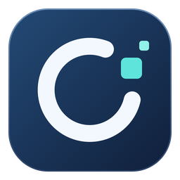

# OmniRecovery



OmniRecovery is an offline-first media recovery and forensic inspection toolkit with a Tauri desktop app, a Rust CLI, and an Android transfer companion. It scans images and readable file exports, captures before/after states, verifies source hashes, and packages selected files for transfer.

[Visual guide](docs/visual-guide.md) · [User manual](docs/user-manual.md) · [Capability matrix](docs/capabilities.md) · [MIT license](LICENSE)

**Project status.** Development release. This build handles previously acquired images and locally accessible files. Live phone acquisition, the forensic case vault, approval enforcement, remote agent pairing, and destructive sanitization execution remain separate milestones.

## Open the desktop app

Get the macOS Universal DMG, Windows x64 desktop and CLI executables, and Android companion APK from the GitHub release when available. On macOS, open the DMG and drag **OmniRecovery** into **Applications**. The icon is a white ring with teal data tiles on a navy square. The macOS bundle is ad hoc signed and unnotarized. The Android APK is debug signed.

Open **Toolbox → Scan media → Try demo** to scan a synthetic image and view its JPEG and PNG findings. Use **Devices & storage** for macOS disk and USB inventory, **Capture & clone** to save a before/after pair, and **Phone clone** to transfer selected files to Android. On macOS, saving recovered media requires a verified separate physical drive. See the [desktop guide](docs/desktop.md).

## Try the development CLI

The macOS app includes `/Applications/OmniRecovery.app/Contents/MacOS/omnirecovery-cli`. The Windows CLI executable runs from PowerShell. The standalone CLI remains usable without the desktop app.

From source, with Rustup available, build using `cargo build --release --locked`. The runtime accepts existing, immutable images and export directories. Use synthetic fixtures during development.

```sh
./target/release/omnirecovery scan userdata.img
./target/release/omnirecovery scan sd-card.dd --storage memory-card
./target/release/omnirecovery scan disk.dd --storage hdd --offset 1048576 --length 67108864
./target/release/omnirecovery compare before.img after.img
./target/release/omnirecovery inventory android-export/
./target/release/omnirecovery compare-exports before-export/ after-export/
./target/release/omnirecovery repair damaged.png
./target/release/omnirecovery backup-files previous-phone-export/ transfer.omnibackup
./target/release/omnirecovery catalog previous-phone-export/ --query DCIM
./target/release/omnirecovery verify userdata.img
```

The image scan verifies the input SHA-256 before and after analysis and decodes contiguous JPEG and PNG candidates. Its JSON includes source offsets, lengths, digests, confidence reasons and skipped ranges. The Rust library can independently re-verify a finding and recover its exact bytes into memory. The CLI emits findings and comparisons. Evidence file export is a later case-service operation.

Run `omnirecovery scan --help` to list storage profiles and range options. `--storage` records the operator-supplied media type in JSON. Byte-range options limit carving, with offsets relative to the original logical image and SHA-256 covering the complete input file.

Open the [offline report viewer](ui/review.html) in a browser to filter scan findings and review repair assessments. See [Repair and phone transfer](docs/repair-and-transfer.md) for supported corruption patterns, archive creation, and restore instructions.

See the [Android recovery workflow](docs/android-recovery.md) for supported inputs, limits and pre/post interpretation. Run `cargo test --locked` to generate and verify the synthetic fixtures.

## Planned operating model

- An examiner can run deterministic recovery recipes locally against evidence already admitted to a case. An autonomous runner or a local model can use the same bounded job interface under a named operator's delegation.
- Device acquisition, evidence export, case deletion and destination sanitization require two distinct authorized people in the high-assurance design. An agent cannot supply either approval.
- The original medium stays outside the recovery workspace. The vault preserves acquired bytes, unreadable ranges, source context and signed custody history. A recovery result identifies its source byte ranges and records whether it is complete, partial or unverified.
- The standalone air-gap profile has an operating-system-enforced network deny policy. A separately deployed lab profile uses an isolated network, mutual TLS and tenant-scoped case storage. Both profiles omit telemetry.

## Design documents

| Document | Review scope |
| --- | --- |
| [Desktop app](docs/desktop.md) | Native app, guided recovery, supported inputs and host builds |
| [Visual guide](docs/visual-guide.md) | Toolbox map and before/after capture flow |
| [User manual](docs/user-manual.md) | Installation, recovery, Android transfer, logs and agent commands |
| [Android recovery workflow](docs/android-recovery.md) | Current commands and expected results after deletion, format or flash |
| [Repair and phone transfer](docs/repair-and-transfer.md) | Deterministic repair, encrypted archive format and Android restore procedure |
| [Cross-platform product design](docs/product-design.md) | Competitor reference workflows, shared theme and implementation priorities |
| [System architecture](docs/architecture.md) | Process boundaries, acquisition, custody, cryptography, identity and deployment |
| [Architecture decisions](docs/decisions.md) | Proposed technology and sequencing choices, with exit criteria |
| [Agent and automation interface](docs/automation.md) | Delegation, typed jobs, offline models and integration contract |
| [STRIDE threat model](docs/threat-model.md) | Trust boundaries, abuse cases, verification and residual risks |
| [Capability matrix](docs/capabilities.md) | Host and target platforms, media, acquisition levels and recovery limits |
| [Assurance and compliance mapping](docs/assurance.md) | Standards, control ownership, supply chain and assessment |
| [Validation plan](docs/validation.md) | Ground truth, release gates, failure injection, fuzzing and benchmarking |
| [Roadmap and build plan](docs/roadmap.md) | Monorepo layout, phased deliverables and review decisions |

## Authorized use

Work only with data and devices you have permission to examine. Before acquisition, record the legal basis or consent, acquisition scope and handling restrictions under a case number. Store the supporting materials in the restricted case record. Device credentials belong in the trusted operator interface. A laboratory should qualify its exact hardware, software and procedures on known-answer cases before relying on results in an examination.
