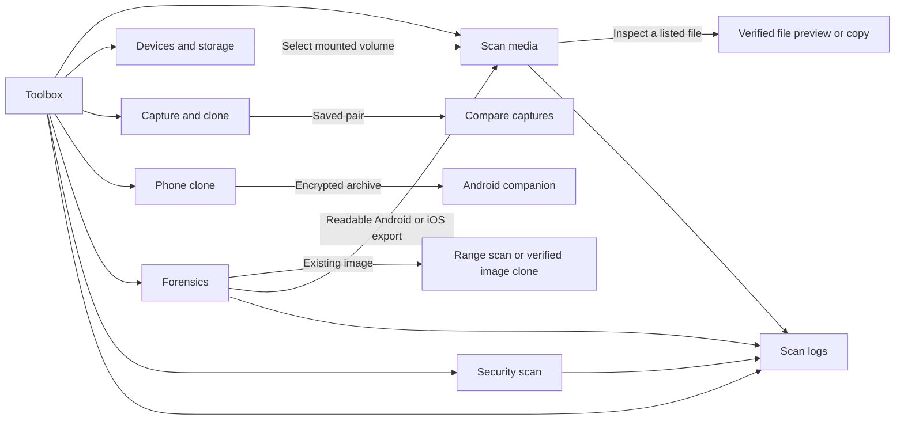
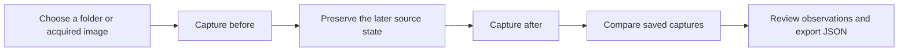
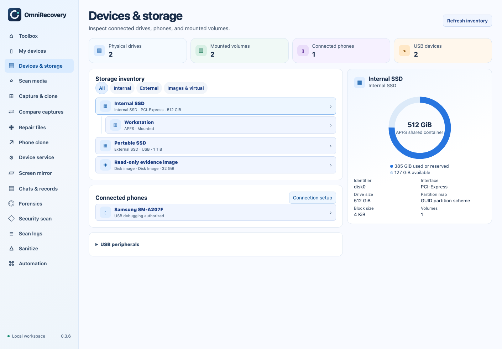
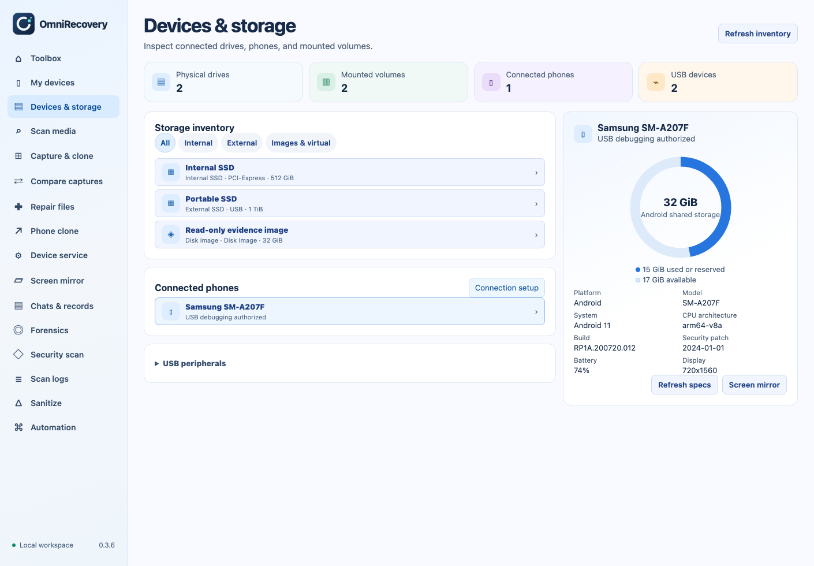
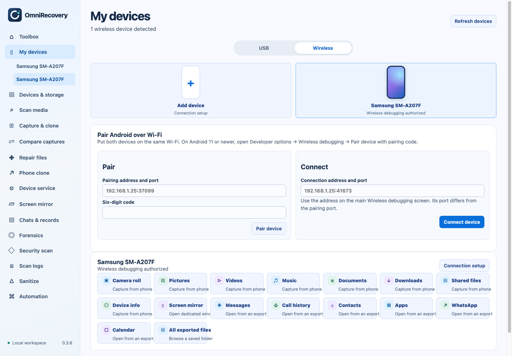
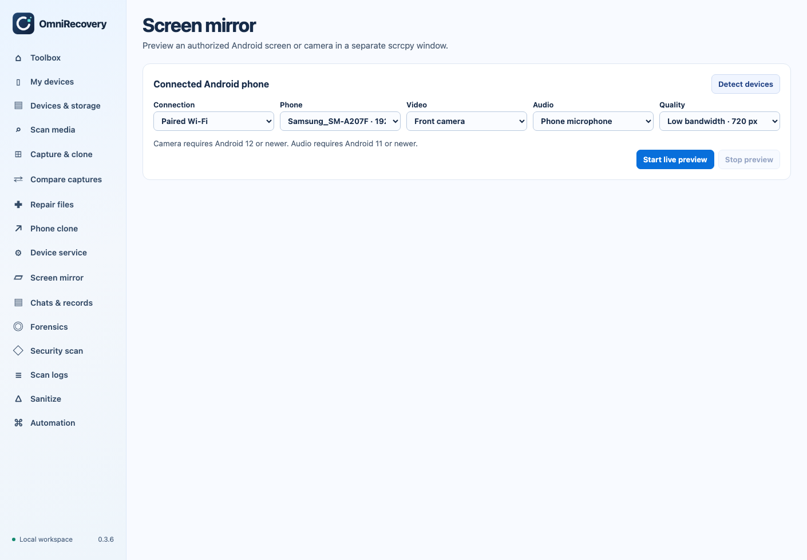
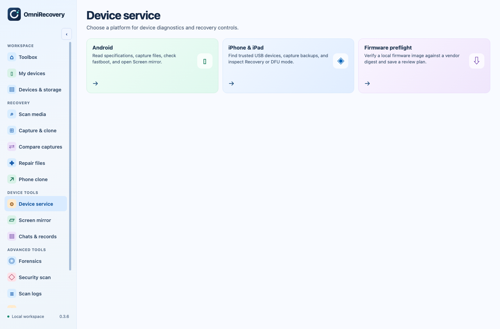
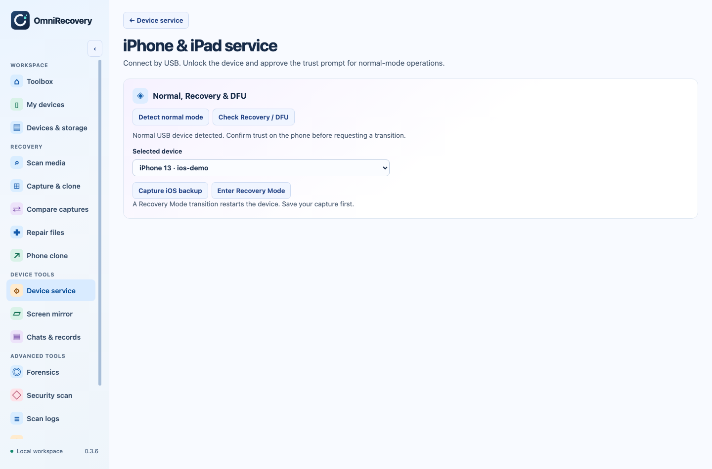
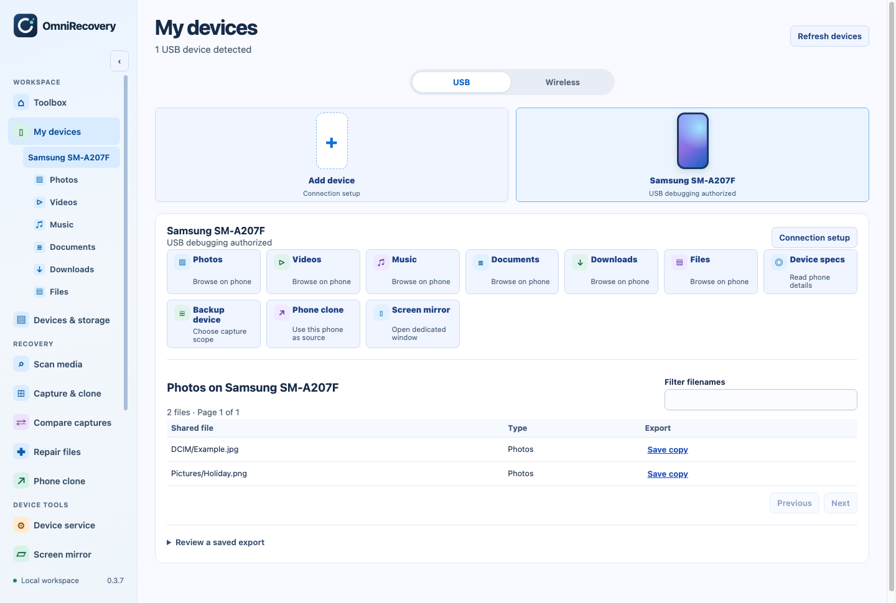
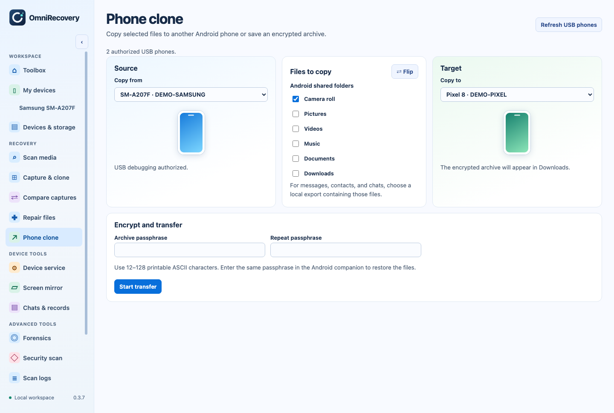

# Visual guide

## Toolbox navigation

The light sidebar is always available. The Toolbox cards open the same workflows. **Sanitize** and **Automation** are separate entries in the sidebar.

## Before and after capture

Take **Before** while the earlier state is still available. Take **After** after the change you want to study. Captures save hashes and observations. Use **Clone image file** or an encrypted file archive when you need to preserve a copy of the bytes.

## Which source should I choose?

| What you have | Where to go |
| --- | --- |
| Raw or Android sparse image | **Scan media → Disk image** |
| External disk mounted by macOS | **Devices & storage → Scan files** |
| Existing export from a phone | **Scan media → Android export folder** or **iOS export folder** |
| A file you want to hash | **Forensics → Verify SHA-256** |
| Acquired image and a known byte range | **Forensics → Run forensic scan** |
| SMS, calls, contacts, mail, WhatsApp, Messenger, or device-info exports | **Forensics → Review phone exports** |
| A suspicious sample or exported text log | **Security scan** |
| Files to copy to another Android phone | **Phone clone → Review files** |

See the [user manual](user-manual.md) for interpretation and export details.

## Browse drives and phone storage

1. Open **Devices & storage** from the sidebar or open its Toolbox card in a separate window.
2. Choose **Internal**, **External**, or **Images & virtual** to filter the inventory.
3. Select a drive to see its interface, partition map and reported block size. Select a mounted volume for available space and its supported actions.
4. Use **Scan files** on an eligible mounted volume to catalogue files.

The chart uses the reported total and available capacity for the selected scope. APFS shares capacity across volumes in a container. The chart labels that scope so the same available space is counted once.

Select an authorized Android phone and choose **Read phone specs** to show its reported model, OS, architecture, battery, display and shared-storage capacity when available.

## Pair a phone and open a live preview

1. On Android 11 or newer, open **Developer options → Wireless debugging → Pair device with pairing code**.
2. In **My devices → Wireless**, enter the phone’s pairing address and its temporary six-digit code.
3. After pairing, use the address from the main Wireless debugging screen to connect. That screen typically shows a different port.
4. Open **Screen mirror**. Choose **USB** or **Paired Wi-Fi**, select the phone, and choose a quality profile. Start with Low bandwidth when testing Wi-Fi.

**Screen mirror** opens a dedicated window and launches the installed upstream scrcpy preview. It uses display-only controls and starts with the phone screen and audio off. For a compatible phone, select Front camera or Rear camera and Phone microphone, then confirm the live preview. Close the preview window or choose **Stop preview** to end it.

Android camera preview requires Android 12 or newer. Audio forwarding requires Android 11 or newer. The screenshots use representative inventory and capacity values. [scrcpy camera guide](https://github.com/Genymobile/scrcpy/blob/master/doc/camera.md) · [scrcpy audio guide](https://github.com/Genymobile/scrcpy/blob/master/doc/audio.md)

## Service a phone

Open **Device service**, then choose **Android**, **iPhone & iPad**, or **Firmware preflight**.

**Android service** shows authorized USB or Wi-Fi phones, device specifications, fastboot detection, capture, and a shortcut to Screen mirror. **iPhone & iPad service** shows normal USB devices, Recovery or DFU status, and available backup or Recovery Mode actions.

## Browse or transfer from a connected phone

Open **My devices**, select an Android phone, then choose a live category in the sidebar or on the device card. The matching files appear on the device page. Use the filename filter to narrow results and **Save copy** to export a selected file.

Choose **Phone clone** on the selected device card to open the transfer workspace with that phone as the source. Choose a second USB phone, select shared folders, and start the encrypted transfer. The Android companion on the receiving phone verifies and restores the archive from Downloads.

