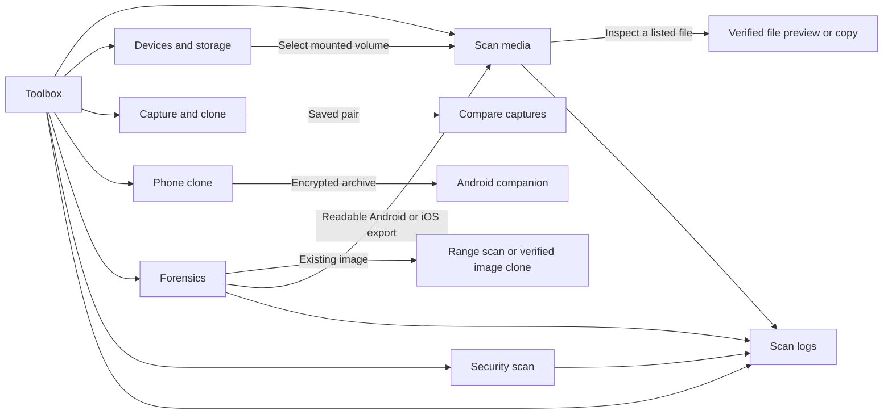
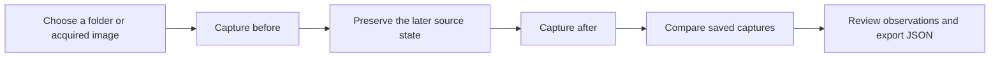

# Visual guide

## Toolbox navigation

The light sidebar is always available. The Toolbox cards open the same workflows. **Sanitize** and **Automation** are separate entries in the sidebar.

## Before and after capture

Take **Before** while the earlier state is still available. Take **After** after the change you want to study. Captures save hashes and observations. Use **Clone image file** or an encrypted file archive when you need to preserve a copy of the bytes.

## Which source should I choose?

| What you have | Where to go |
| --- | --- |
| Raw or Android sparse image | **Scan media → Disk image** |
| External disk mounted by macOS | **Devices & storage → Scan files** |
| Existing export from a phone | **Scan media → Android export folder** or **iOS export folder** |
| A file you want to hash | **Forensics → Verify SHA-256** |
| Acquired image and a known byte range | **Forensics → Run forensic scan** |
| SMS, calls, contacts, mail, WhatsApp, Messenger, or device-info exports | **Forensics → Review phone exports** |
| A suspicious sample or exported text log | **Security scan** |
| Files to copy to another Android phone | **Phone clone → Review files** |

See the [user manual](user-manual.md) for interpretation and export details.
